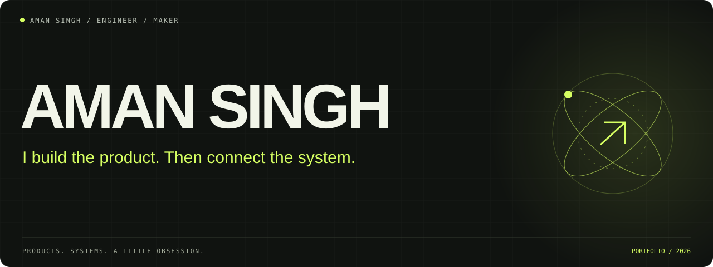
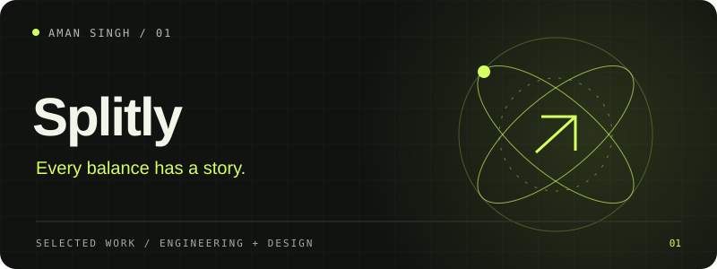
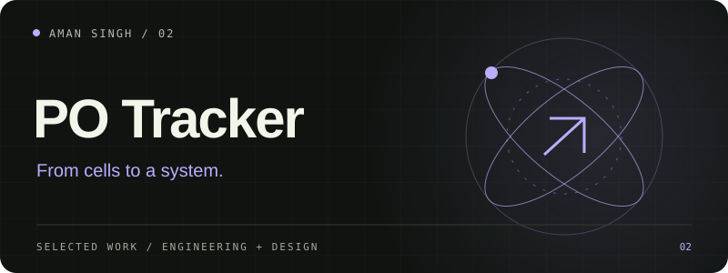
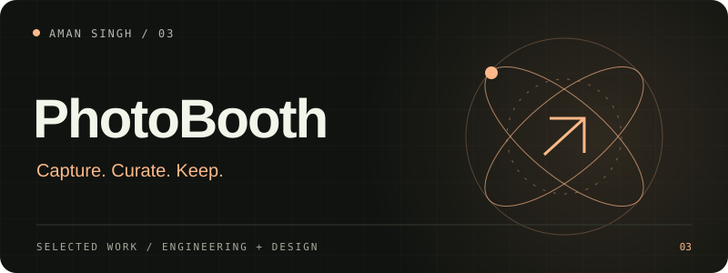
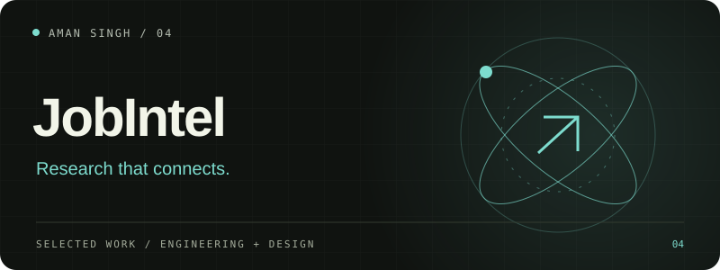
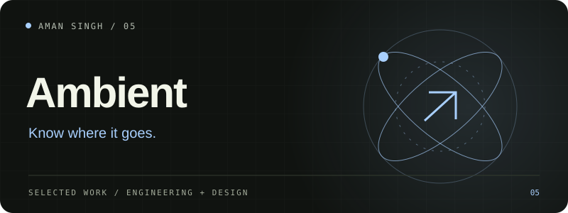
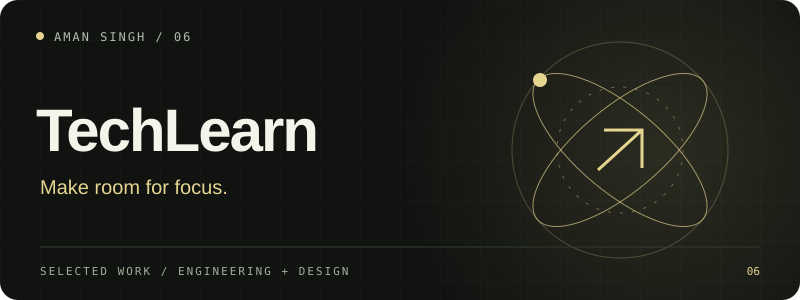

<a href="https://www.linkedin.com/in/aman-singh-401a48306/"><b>LINKEDIN ↗</b></a> &nbsp; / &nbsp; <a href="mailto:amansingh271204@gmail.com"><b>LET'S TALK ↗</b></a> &nbsp; / &nbsp; <a href="PROJECTS.md"><b>PROJECT DIRECTORY ↗</b></a>

### Full-stack developer. Automation engineer. Detail enthusiast.

I turn complicated workflows into products people can understand. My work moves between **React interfaces, Python backends, AI workflows and the integrations that connect them** — with a close eye on how the whole thing feels to use.

B.Tech CSE · AI & ML · **Manipal University Jaipur, 2027** · **9.0/10 CGPA**  
Currently developing **Tenary**, an independent automation venture.

 

## Selected builds

<table>
<tr>
<td width="50%" valign="top"><h3><a href="https://github.com/aman-singh27/splitly-decentro-assignment">Splitly ↗</a></h3>
Expense sharing with exact money calculations, custom splits and explainable balances.

Django · React · TypeScript
</td>
<td width="50%" valign="top"><h3><a href="https://github.com/aman-singh27/PO-Tracker">PO Tracker ↗</a></h3>
A purchase-order workspace with fast entry, revisions, migration review and audit history.

Django · DRF · React
</td>
</tr>
<tr>
<td width="50%" valign="top"><h3><a href="https://github.com/aman-singh27/photo_app">PhotoBooth ↗</a></h3>
Android capture, a desktop gallery, vintage strips and a print-queue handoff.

Kotlin · CameraX · Python
</td>
<td width="50%" valign="top"><h3><a href="https://github.com/aman-singh27/ACE-CONSULTING">JobIntel ↗</a></h3>
Job discovery, company research, scoring and CRM workflows in one workspace.

React · FastAPI · PostgreSQL
</td>
</tr>
<tr>
<td width="50%" valign="top"><h3><a href="https://github.com/aman-singh27/ambient-expense-tracker">Ambient ↗</a></h3>
A browser-local ledger for bank and cash entries, spending review and CSV export.

React · TypeScript · Vite
</td>
<td width="50%" valign="top"><h3><a href="https://github.com/aman-singh27/techlearn">TechLearn ↗</a></h3>
A document-style learning MVP with topic navigation and a structured content API.

React · Express · MongoDB
</td>
</tr>
</table>

<a href="PROJECTS.md"><b>Explore the full project directory →</b></a>

## Beyond the repository

Some of my work lives inside teams and company products. These are contributions, with their own boundaries:

- **rkitect.ai** — SketchUp capture and rendering workflows, 360° views and iterative AI edits; also content-generation and review pipelines. [Contribution notes](case-studies/rkitect.md).
- **NavPal** — collaborative indoor maps, QR anchors and graph routing. Campus deployment was under review.
- **Campus Hub** — authentication, access flows and event/food experiences built with the university team.

## My working set

| Product interfaces | APIs & data | AI & automation | Delivery & craft |
| :--- | :--- | :--- | :--- |
| React · TypeScript | Python · Django · DRF | Gemini · OpenRouter | Git · Docker |
| Next.js · Vite | FastAPI · Express | n8n · Playwright | Figma · GSAP |
| HTML · CSS | PostgreSQL · MongoDB | OCR · workflow orchestration | Kotlin · SketchUp / Ruby |
| Responsive design | Firebase · Supabase | Webhooks · review pipelines | Accessible interfaces |

 

> Good software should make the next step obvious.

If you're building something useful, I'd like to hear about it.  
**[amansingh271204@gmail.com](mailto:amansingh271204@gmail.com)** · [LinkedIn](https://www.linkedin.com/in/aman-singh-401a48306/)

Project status and scope are documented in the directory. Team contributions are credited; company source and private operational data stay private.
